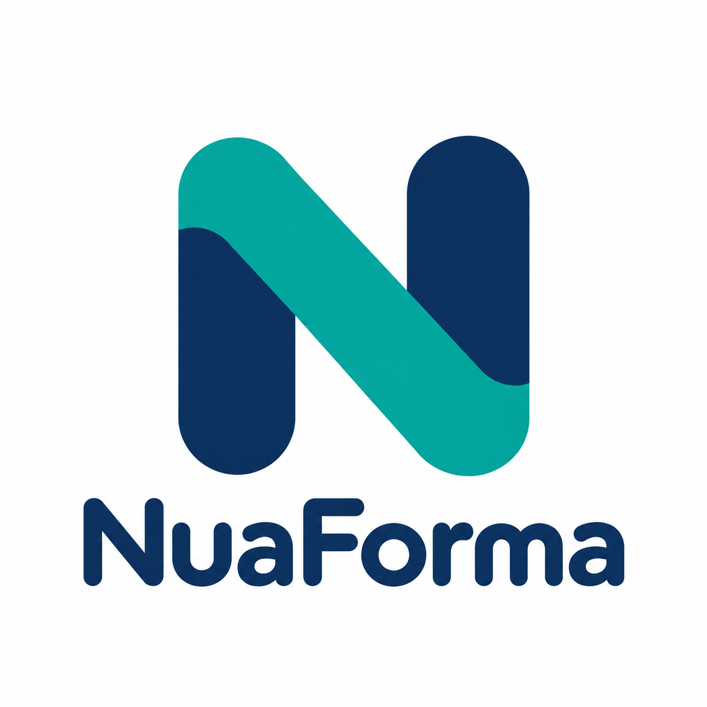

<p align="center">
  <picture>
    <source media="(prefers-color-scheme: dark)" srcset="assets/branding/nuaforma-dark-transparent.png">
    <source media="(prefers-color-scheme: light)" srcset="assets/branding/nuaforma-light.png">
    
  </picture>
</p>

# NuaForma

[](https://central.sonatype.com/artifact/dev.nuaforma/nuaforma-core)
[](https://repo.nuaforma.dev/#browse/browse:nuaforma-prereleases:dev%2Fnuaforma%2Fnuaforma-core)
[](https://repo.nuaforma.dev/#browse/browse:nuaforma-snapshots:dev%2Fnuaforma%2Fnuaforma-core)
[](https://sonarcloud.io/dashboard?id=NuaForma_NuaForma&branch=develop)

**Turn templates and structured data into documents.**

NuaForma is an open-source document-generation engine. Combine a Word template, structured data and generation options to produce DOCX or PDF documents. Embed the Java-17-compatible libraries in your application, or run the REST service in your own infrastructure.

> **Native PDF engine:** selected release `0.5.0-alpha.2` converts DOCX with NuaForma's own shared PDF engine. LibreOffice, Microsoft Word and a cloud conversion service are not runtime requirements. Consult the [release](https://github.com/NuaForma/NuaForma/releases/tag/v0.5.0-alpha.2) for matching published libraries, images and source materials once publication completes. APIs remain an evaluation draft.

The 0.5 series adds [Boolean checkbox content](docs/checkbox-content.md), rendered as inline vectors with optional boxes, checks/crosses and inherited size/bold styling. It broadens the qualified Word profile for fields/bookmarks, JPEG and passive package metadata, supplied-font metrics/synthetic bold, justified text, character spacing and paragraph-style defaults. Table layout adds preferred widths, minimum row heights, cell margins/indentation and qualified first-row fragmentation. See the [release notes](release-notes/0.5.0-alpha.2.md) for scope and public-model changes.

Standard PDF and PDF/A-1b/2b/3b retain independently validated output and embedded caller fonts. The native reader and Playground cleanup admit up to 256 package members within existing byte and caller limits. Source-embedded fonts remain passive; supply every required face through the deployment/caller catalog. The [Playground cleanup report](docs/template-cleanup.md) and precise development diagnostics help identify unsupported content; normal generation remains strict. Runtime contract 0.10 retains compatible older providers, while the PDF provider requires 0.10. APIs remain an evaluation draft and ODT remains future work.

New alpha/beta/RC Maven versions and snapshots use the [NuaForma Nexus repositories](docs/nexus-publishing.md); stable releases use Maven Central. Existing Central publications remain available.

## What it supports

- Preserve supported styles, branding, tables, headers/footers, text boxes and page geometry while filling templates.
- Use nested objects and lists, conditions, repetitions, null fallbacks and explicit number/date formatting.
- Produce DOCX, standard PDF 1.7 or PDF/A-1b, 2b and 3b. PDF defaults to PDF/A-3b; independent conformance validation is enabled by default.
- Supply exact fonts with permission-checked subset/full embedding. DOCX and native standard PDF/PDF-A-2b/3b support requested text watermarks with dynamic text, RGB color, opacity and rotation. PDF/A-1b rejects every requested watermark.
- Render PDF in the hosting JVM with request-local state and bounded admission. Independent PDFBox/veraPDF checks run in a separate bounded Java 17 process.
- Deploy the production service or the separate development Playground on native Linux AMD64/ARM64.

These are qualified, bounded profiles, not universal Word compatibility. Unsupported source constructs reject explicitly. PDF/A-1b rejects transparency. See the [PDF profile](nuaforma-docx-pdf/README.md) and [roadmap](docs/architecture/own-engine-roadmap.md) for support and remaining limits.

## Get started

### Run the source container

Follow the [service build and deployment guide](deployment/pdf-runtime/SERVICE.md) to prepare the application, validator runtime and container. The image includes the native engine, selected fonts and independent validators. It contains no LibreOffice and performs no dependency downloads during generation.

The [REST guide](nuaforma-server/README.md) describes uploads, options and responses. The [Playground](nuaforma-playground/README.md) is a separate development application: use synthetic data because development logging can include document contents and field values. Keep remotely accessible services behind an authenticated TLS gateway.

### Embed the engine

Use `dev.nuaforma:nuaforma-core` with `nuaforma-docx` for Word generation. Add `nuaforma-docx-pdf` for DOCX-to-PDF; it reuses `nuaforma-docx` and the shared `nuaforma-pdf` artifact. Configure caller fonts and the independent validator through [NativePdfConfiguration](nuaforma-docx-pdf/README.md#embedded-configuration). Embedded generation needs no server, Docker or Office installation.

The [Java/Maven and Kotlin/Gradle examples](examples/embedded/README.md) consume locally staged libraries independently of the source build. [nuaforma.dev](https://nuaforma.dev) is the project website; use this checkout's guides for the native source profile.

### Write a template

Keep the desired styling in Word and insert markers such as:

```text
Dear {trim(customer.name)},
Contact: {customer.email ?? "Not provided"}
You {#if active}have an active agreement{#else}do not have an active agreement{/if}.
{#each items as item}{item.name}: {item.amount | number("0.00")}{/each}
```

Supply the corresponding `data` object. Inserted values remain literal, not executable template code. See the [language specification](nuaforma-template/README.md) and [Word template rules](nuaforma-docx/README.md#word-template-rules).

## Documentation and development

- [Documentation index](docs/README.md) and [development guide](docs/development.md).
- [Shared PDF engine](nuaforma-pdf/README.md), [conversion design](docs/architecture/conversion-engine.md) and [Word comparisons](tools/pdf-evaluation/own-engine/README.md).
- [Engine golden files](nuaforma-pdf/src/test/resources/visual-goldens/README.md): reviewed references protected by automatic image-comparison tests.
- [Extension guide](docs/extensions.md), [contribution guide](CONTRIBUTING.md) and [open issues](https://github.com/NuaForma/NuaForma/issues?q=is%3Aissue%20is%3Aopen).

## License

NuaForma's code is [Apache-2.0](LICENSE). Dependencies, fonts and bundled runtime components retain their own licenses; the combined container is not wholly Apache-2.0. See [third-party notices](THIRD_PARTY.md) and the [runtime distribution checklist](docs/runtime-distribution.md).

Copyright 2026 NuaForma contributors.

Version 0.4.0-alpha.4 preserves qualified floating header/footer logos and frames, page fields and nonprinting paragraph-mark highlight through cleanup and PDF rendering. See the [floating-story profile](tools/pdf-evaluation/own-engine/WORD_FLOATING_BANDS.md) and [release notes](release-notes/0.4.0-alpha.4.md).

Selected 0.5.0-alpha.2 identifies the missing font family and requested variant in Playground diagnostics, with source coordinates where available. Production retains restricted diagnostics; font selection and conversion support are unchanged. See the [release notes](release-notes/0.5.0-alpha.2.md), [candidate audit](docs/release-0.5.0-alpha.2-audit.md) and [provider profile](nuaforma-docx-pdf/README.md). Published availability follows the protected release workflow.
