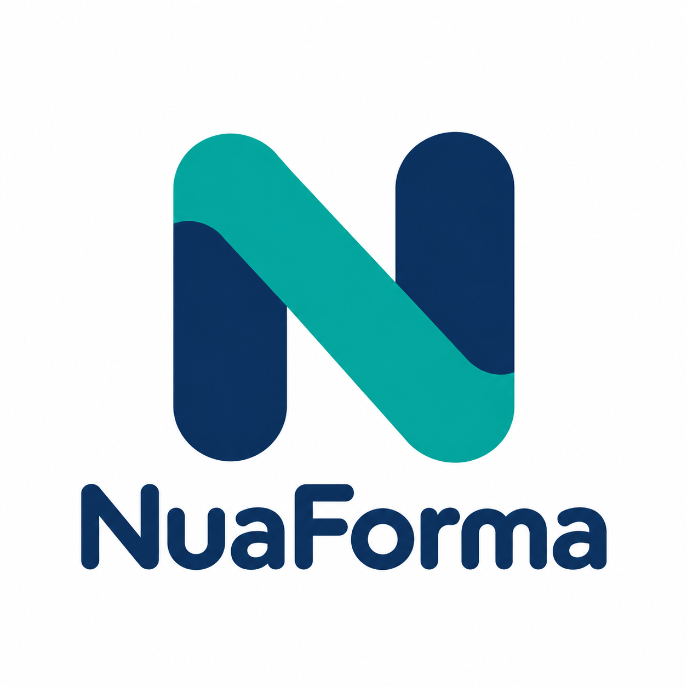

<p align="center">
  <picture>
    <source media="(prefers-color-scheme: dark)" srcset="assets/branding/nuaforma-dark.png">
    <source media="(prefers-color-scheme: light)" srcset="assets/branding/nuaforma-light.png">
    
  </picture>
</p>

# NuaForma

**Turn templates and structured data into documents.**

NuaForma is an open-source document generation project for businesses,
institutions, and developers. Its goal is to combine reusable templates with
structured data to produce documents in multiple formats, through a generic,
self-hostable service.

From a simple letter to an agreement with conditional sections, NuaForma aims
to make document automation accessible without locking users into a proprietary
platform.

> **Project status:** development-stage provider contracts, core discovery/selection, a registered [DOCX generation provider](nuaforma-docx/README.md) and a [restricted template language](nuaforma-template/README.md). Embedded Kotlin/Java 17 applications can generate DOCX with split-run placeholders, inline and paragraph/row conditions and scoped repeats while preserving native Word structures, including supported text boxes and selected fonts. Optional supplied-font validation and embedding follow technical font permissions; the module guide defines the supported profile and verified barcode fixture. Requested watermarks, PDF conversion, REST and a runnable service remain planned; no stable release is claimed.

## The idea

A generation request combines three things:

- A **template** describing the layout, placeholders, and document logic.
- **Structured data** supplying the values to insert.
- An **output format** specifying the document to produce.

Templates should support more than replacing a name or date. Authors should be
able to include or omit text blocks based on conditions, choose between
alternative sections, and repeat content for lists or tables.

For example, an agreement could include one clause when `x == 1`, use another
when `y == 1`, and omit a section when neither condition applies. The template
defines those choices; the input data determines the result. The template
syntax is specified in the [template language guide](nuaforma-template/README.md); the [DOCX guide](nuaforma-docx/README.md) explains structural markers and formatting rules.

## Planned capabilities

- **Placeholders:** insert values from structured input, with formatting for
  dates, numbers, and other common data types.
- **Conditional content:** include, omit, or select blocks using understandable
  template rules.
- **Repeated content:** generate rows or sections from collections.
- **Optional watermarks:** add configurable text such as `CONCEPT` to every page of DOCX and PDF output without shifting the document layout.
- **Multiple output formats:** target PDF, Microsoft Word (DOCX), and
  OpenDocument Text (ODT, used by LibreOffice and OpenOffice).
- **PDF profiles:** explore archival output such as PDF/A, with conformance
  validation before claiming support for a specific profile.
- **REST integration:** submit templates and data through an API.
- **Stored templates and data:** generate documents using identifiers instead
  of submitting all inputs with every request.
- **Optional database adapters:** retrieve templates or input data from
  connected systems.
- **Self-hosting and extensibility:** support internal deployments, integrations,
  and custom adaptations.

OpenDocument Spreadsheet (ODS) output is also under consideration. It is a
spreadsheet format, distinct from ODT, and would require its own generation
workflow.

These are design goals, not a commitment that every template can be converted
to every output format with identical layout. Supported template types, output
combinations, and rendering limitations will be documented as they are chosen.

## Who is it for?

NuaForma is intended for teams generating letters, reports, agreements,
statements, and other documents from application data. It should be useful
both as an internal service and as a component integrated into other products.

The project uses Kotlin/JVM with Java 17 as its minimum runtime. DOCX round-trip processing uses docx4j behind NuaForma-owned facades. The restricted language is implemented separately from document libraries; the PDF conversion backend still needs to be selected and verified.

## Initial development direction

1. Establish the module build and test foundation.
2. Define the public contracts and provider discovery.
3. Implement DOCX generation with placeholders, conditions, repeats and optional watermarks while preserving formatting.
4. Select and verify an optional DOCX-to-PDF backend for the first product versions.
5. Expose the engine through REST with downloadable OpenAPI JSON and YAML, then prepare Docker deployment and embedded usage examples.

Track scoped work in the [GitHub roadmap issues](https://github.com/NuaForma/NuaForma/issues?q=is%3Aissue%20label%3Aroadmap) and [milestones](https://github.com/NuaForma/NuaForma/milestones). Later format and storage extensions are separate follow-up work.

Security will be part of the design: untrusted templates, rendering processes,
database access, and sensitive document data need explicit boundaries and
resource limits.

## Development

Install a JDK 17 and use the checked-in Gradle Wrapper; no global Gradle installation is required. The first build downloads the pinned Gradle distribution and dependencies. Its distribution checksum is verified by the wrapper.

```sh
./gradlew build
./gradlew test
./gradlew :nuaforma-core:test --tests dev.nuaforma.core.TestStackTest
./gradlew verifyBuildStructure
./gradlew :nuaforma-server:test --tests 'dev.nuaforma.architecture.*'
./gradlew :nuaforma-docx:test
./gradlew :nuaforma-template:test
./gradlew generatePomFileForMavenJavaPublication
```

On Windows, use the corresponding `gradlew.bat` launcher. The five library modules have Maven publication metadata plus source and Javadoc JAR tasks; no remote publication destination is configured. The [contracts module](nuaforma-contracts/README.md), [core module](nuaforma-core/README.md), [DOCX module](nuaforma-docx/README.md) and [template module](nuaforma-template/README.md) contain development APIs usable from Java and Kotlin, not stable published APIs. Core supports local classpath discovery, explicit registration, deterministic selection and delegation to accepted providers. DOCX has a registered template-processing provider and a separate standalone read/write facade; DOCX-to-PDF remains a scaffold. The template module compiles and renders text independently of core and document libraries. The server is a buildable module without an HTTP framework, entry point or service packaging.

JUnit Jupiter runs the tests; MockK and ArchUnit are test-scoped. Tests verify Java 17 execution, Java/Kotlin API use, structured data, provider capability/option models, cancellation, stream ownership and static contract metadata. Core integration tests compile independent provider JARs and exercise actual ServiceLoader discovery, metadata validation before provider loading, selection and concurrent delegation. Repository-wide ArchUnit rules inspect main outputs from all six modules and enforce dependency direction, Kotlin/internal access, adapter ownership, public signature boundaries and component cycles, with independently compiled violating fixtures. DOCX integration tests compare an independently authored package before/after a real docx4j round trip and cover native template processing, font metadata and embedding, invalid inputs, budgets, safe diagnostics, lifecycle and concurrent isolation. Language tests exercise nested inline conditions, scopes, formatting, invalid constructs, literal-data safety and resource budgets. The build also verifies runtime module dependencies and prevents test libraries from leaking into production dependencies. API contract generation belongs to a subsequent issue.

Dependency versions and review notes are in [DEPENDENCIES.md](DEPENDENCIES.md). Design boundaries are in [ARCHITECTURE.md](ARCHITECTURE.md); contributor instructions are in [AGENTS.md](AGENTS.md).

## Pull requests and build checks

Changes to `main` go through pull requests with verified signed commits. The required GitHub Actions check is named `Build (Java 17)` and runs the full build, tests, scaffold dependency checks and Maven POM generation on Java 17. It runs for pushes and pull requests without path filters, so documentation-only changes also receive the required check. Keep the branch up to date with `main` before merging.

[CODEOWNERS](.github/CODEOWNERS) assigns repository ownership to `@mrhoeve`. Review approval is not required while the project has one human maintainer; authors cannot approve their own pull requests. Force-pushing and deleting `main` are blocked. Repository administrators have no configured ruleset bypass. These protections are configured in GitHub, not applied merely by adding this documentation.

GitHub Actions are pinned to full commit hashes and use a read-only repository token. The workflow checks the Gradle Wrapper JAR against its published checksum before execution; the distribution checksum is verified by the wrapper itself. When updating Gradle, update and verify both checksums. No publishing or deployment occurs in this workflow.

## Contributing

The project is at the foundation stage. Feedback, use cases, example
templates with synthetic data, and technical proposals are welcome.

Do not submit personal data, credentials, or confidential documents. A
dedicated contribution guide will be added as the initial implementation takes shape.

The GitHub organization is [NuaForma](https://github.com/NuaForma).

## License

NuaForma is licensed under the [Apache License 2.0](LICENSE).

The license permits commercial and internal use, modification, and
redistribution, including use in proprietary products, subject to its terms.
It does not require publishing private modifications. Distributed copies must
comply with the license's notice and attribution requirements.

Third-party dependencies retain their own licenses and will be documented
when introduced. The Apache License does not grant trademark rights.

Copyright 2026 NuaForma contributors.

