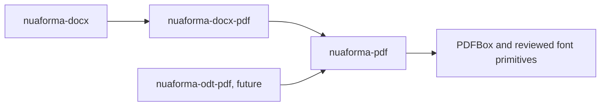

# Own PDF conversion engine: technical design and implementation plan

Status: native DOCX conversion is integrated into the registered provider and source container, using the shared `nuaforma-pdf` model/layout/writer. Standard PDF 1.7 and PDF/A-1b, 2b and 3b are qualified for the bounded profile. The [module guide](../../nuaforma-pdf/README.md), [provider guide](../../nuaforma-docx-pdf/README.md) and [roadmap](own-engine-roadmap.md) define current support and remaining limits. This design also describes future capabilities, including ODT; those are not implemented support claims.

The [paper-format proof](../../tools/pdf-evaluation/own-engine/PAGE_FORMATS.md) additionally qualifies standalone A4, A3, US Letter and Legal reports in portrait/landscape, including asymmetric margins and Greek/Cyrillic text. The [mixed-size proof](../../tools/pdf-evaluation/own-engine/SECTIONS.md) adds resolved neutral `PdfPageSequence` ranges, each starting on a fresh page, with continuous PAGE numbering and inherited default source bands. The [page-band variants](../../tools/pdf-evaluation/own-engine/PAGE_MASTERS.md) add first/even/odd and explicit blank stories with source inheritance. Dynamic margins and continuous/explicit odd/even/column transitions remain planned.

The [page-field proof](../../tools/pdf-evaluation/own-engine/FIELDS.md) adds global decimal PAGE/NUMPAGES in fixed reserved bands after all body ranges have been paginated. The [sequence-numbering follow-up](../../tools/pdf-evaluation/own-engine/NUMBERING.md) adds bounded decimal restarts/continuation, SECTIONPAGES and explicit parity padding. General field evaluation and other numbering formats remain unqualified.

The [cell-alignment trials](../../tools/pdf-evaluation/own-engine/CELL_ALIGNMENT.md) add neutral top/center/bottom policies over naturally measured fixed table rows, including bounded spans, nested tables and page-band copying. Non-TOP cells crossing physical page fragments reject explicitly. The [natural-width trials](../../tools/pdf-evaluation/own-engine/NATURAL_WIDTHS.md) add bounded unwrapped text sizing over the neutral table-width policy. General AutoFit redistribution and broader combinations remain planned. The [solid cell-border qualification](../../tools/pdf-evaluation/own-engine/CELL_BORDERS.md) adds per-side solid strokes/removal with one resolved style per source table. The [table-combination proof](../../tools/pdf-evaluation/own-engine/BORDER_COMBINATIONS.md) additionally covers spans, one nested level, whole-row pagination and Letter. The [row-fragment proof](../../tools/pdf-evaluation/own-engine/BORDER_FRAGMENTATION.md) extends this to explicitly splittable TOP-aligned rows with horizontal spans on A4 and Letter. Conflicting styles and oversized non-splitting custom-border rows remain unqualified.

## 1. Baseline, scope and constraints

NuaForma already provides DOCX template processing, provider contracts, REST and a separate Playground. The registered DOCX/PDF provider now uses the shared native renderer. Keep current supported profiles and remaining work explicit in the module guides and roadmap.

The engine will read DOCX first and ODT later, preserve supported styling, and generate PDF without Word, LibreOffice, Euro-Office, or an intermediate HTML rendering pipeline. Small differences in line wrapping and pagination are acceptable; missing content, lost branding, accidental overlap and unexplained style changes are not.

The production DOCX reader lives in `nuaforma-docx-pdf`; source-specific styles and structures map into the neutral `nuaforma-pdf` model. Rendering executes in-process, while independent Java 17 validation remains isolated. LibreOffice is absent from the production path and container. Unsupported source features reject explicitly. New topic branches start from and target `feature/own-pdf-engine`.

- Keep independently written NuaForma code under Apache-2.0. Required functionality must use freely usable open-source components, without commercial licenses, evaluation keys or mandatory cloud services.
- Reuse open-source ZIP/XML, Unicode, font and PDF primitives. Own the document interpretation, style resolution, page layout and conversion policy.
- Preserve the existing baseline: embedded libraries, including the planned `nuaforma-pdf`, target Java 17 APIs and bytecode. Server and Playground remain on Java 25; validator child JVMs remain on their qualified Java 17 runtime. No JVM migration is authorized here.
- Preserve the existing provider contracts, template language and DOCX generation responsibilities. A different backend does not authorize incompatible public API changes or silent output-profile changes.
- First prove ordinary PDF. Qualify individual archival profiles separately; an implementation option or metadata label is not evidence of conformance.
- Unsupported layout features require explicit diagnostics or rejection. Never silently switch to an external converter.
- Keep the product in the existing Gradle multi-project repository. The M0 source change adds only the agreed shared artifact and its verification/example integration; it does not add a new conversion provider, workflow, tag or public release.

[ARCHITECTURE.md](../../ARCHITECTURE.md) owns architectural decisions. [Branch workflow](../branch-workflow.md#own-pdf-engine-integration-branch) owns the branch/release agreement. This document elaborates the own-engine design rather than replacing current module guides.

## 2. Agreed package structure

There is **one new shared engine artifact**, `nuaforma-pdf`. The existing `nuaforma-docx-pdf` will use it; a future `nuaforma-odt-pdf` will use the same engine.



| Artifact | Responsibility | Dependency direction |
|---|---|---|
| `nuaforma-pdf` | Shared document model, style resolution, font handling, layout, PDF output, validation orchestration, diagnostics and bounded conversion execution | No dependency on DOCX/ODT adapters or server; reviewed platform/PDF/font libraries only as needed |
| `nuaforma-docx-pdf` | Existing provider and DOCX-specific integration; translate filled DOCX into the shared model and invoke the shared engine | Reuse `nuaforma-docx`, preserve existing contracts, add `nuaforma-pdf` when implemented |
| `nuaforma-odt-pdf` | Future ODT-specific translation and provider integration | Use `nuaforma-pdf`; no dependency on the DOCX adapter |

`nuaforma-pdf` does not understand OOXML/ODF element names, own a second template language, or register itself as a DOCX/ODT provider. Format adapters retain responsibility for their input and the supported read/write combinations. In particular, `nuaforma-docx-pdf` must continue to support DOCX output through its existing delegate; its public capability is not reduced to PDF-only.

Use a small public facade and shared types under `dev.nuaforma.pdf`. Organize model, style, fonts, layout, backend, validation and runtime details into internal packages within **the same artifact**. Do not turn these responsibilities into separately published `conversion-*` modules. A diagnostic CLI or worker entry point is an internal/executable concern; HTTP orchestration stays in the existing server, and development UI stays in Playground. Test helpers belong in test source sets unless a concrete reuse requirement is approved.

DOCX ZIP/XML interpretation belongs to its adapter, reusing the existing private docx4j boundary where suitable. A future ODT reader can use its own bounded parser. Share neutral resource-budget primitives where necessary, but do not add another general-purpose archive/parser artifact in anticipation of future work. PDFBox, docx4j and parser implementation types must not leak into public shared model types.

## 3. Pipeline and representations

```text
Filled DOCX -> DOCX adapter --+
                             +-> DocumentModel -> support assessment
Filled ODT  -> ODT adapter ---+       -> style/font resolution -> ResolvedDocument
                                     -> line/table/page layout -> LayoutDocument
                                     -> PDF writing -> required checks -> result
```

Three separate representations keep reading, layout and writing independent:

1. `DocumentModel`: format-neutral content, style rules, semantic roles, source references and page policy.
2. `ResolvedDocument`: concrete effective properties, resolved fonts and page policies. Layout does not repeatedly infer source inheritance.
3. `LayoutDocument`: positioned pages, glyph runs, images, paths, links and semantic node references. PDF output performs no new line breaking.

Templates and data are evaluated by existing generation components before conversion. Later direct generation into the shared model may reuse the engine, but is not part of the initial implementation.

## 4. Shared document model, including ODT requirements

### Content and provenance

```text
DocumentModel
  modelVersion, metadata, defaultLanguage
  styles: StyleCatalog
  pageMasters: Map<PageMasterId, PageMaster>
  pagePolicies: Map<PagePolicyId, PageSequencePolicy>
  stories: Map<StoryId, Story>
  resources: ResourceCatalog
  mainStoryId, sourceMap

Story = id + ordered blocks
Block = Paragraph | Table | Frame | FlowBreak | UnsupportedBlock
Inline = TextRun | InlineImage | Tab | LineBreak | Field | Bookmark | UnsupportedInline
```

These are schematic types, not implemented public contracts. A story represents body text, a header/footer or a text frame. Table cells contain blocks. Frames contain a resource or story. Preserve Unicode text, language, direction, heading/list roles, hyperlink ranges and alternative text. Each node has a stable ID and a source reference containing input format, package part and element location.

Unsupported nodes contain a feature code and source reference, not executable XML. Assessment considers the selected display policy, including hidden/revision content, rather than treating every unused source element as a visible failure.

### Styles

Distinguish absent/inherited values, explicit resets, and explicit values such as `false`, zero or no border. Detect inheritance cycles. Model text attributes, paragraph alignment/indents/tabs/spacing, keep rules, table sizing/padding/borders/merges, and image size/crop/position.

Source inheritance is not identical between DOCX and ODT. The DOCX adapter translates document defaults, themes, paragraph/character/table styles and numbering overrides into explicit rules. The ODT adapter translates default, common and automatic styles according to ODF semantics. The shared resolver evaluates those prepared rules; it must not impose an oversimplified universal source cascade.

### Page masters and flow changes

```text
PageMaster
  size, margins, gutter, background, writingMode
  bodyRegion, headerRegion, footerRegion
  headerStoryId?, footerStoryId?

PageSequencePolicy
  firstMaster?, oddMaster, evenMaster?, nextPolicy?
  pageNumberStart?, pageNumberFormat

FlowBreak
  kind: LINE | PAGE | COLUMN | CONTINUOUS | ODD_PAGE | EVEN_PAGE
  nextPagePolicyId?, pageNumberRestart?
```

Do not define the whole model in terms of Word sections. DOCX section properties apply to source ranges and are often stored at the end of a range; resolve their scope and inherited headers correctly. ODT page layouts, master pages, next-style transitions and style-triggered page breaks map to the same neutral policy. An ODT text section may group content or define columns without being a page-style change.

Keep first/odd/even pages, page dimensions and numbering restarts separate. Model future continuous transitions and columns, but reject them until implemented rather than silently approximating them.

### Anchors, geometry and semantics

Frames retain anchor kind (page/paragraph/character/cell), reference rectangle (page/margins/text/column), offsets or alignment, wrapping policy, z-order and wrap distances. Early support may be narrower than the model.

Represent absolute, percentage, automatic and relative lengths distinctly. Convert absolute DOCX twips/EMU and ODT dimensions to fixed micro-points; resolve percentages only when the reference size is known. One point is 1/72 inch. Layout may use floating-point calculations with explicit stable rounding, never pixel rounding for document geometry.

Preserve headings, list structure, table headers, language, alternate text and logical reading order. Positioned content retains semantic node IDs so future tagged PDF is possible. This preparation does not qualify PDF/UA or reconstruct missing author-provided meaning.

For roadmap part 12, the maintainer explicitly requested preparation for PDF/A-1a, 2a and 3a. Keep heading levels, TOC/entry roles, caption labels and associations, reference text and link/target relationships in the shared source-neutral model. Give logical nodes stable identities that survive generated fields, bounded relayout, pagination and fragmentation. Each painted fragment must retain its logical owner; preserve reading order separately from drawing order. Generated TOC entries must retain their connection to actual headings, and captions must retain known figure/table associations rather than becoming indistinguishable plain text. Do not invent an association or meaning missing from the input. This also leaves the later ODT reader able to supply the same semantics.

Part 12 tests must check semantic hierarchy, target relationships and identity/order stability through field iteration and page breaks alongside the existing visual/content tests. Version-appropriate PDF tags, marked-content/annotation associations, structure trees and independent level-A validation remain part 15b; existing B profiles and claims do not change. PDF/A level A and PDF/UA have separate acceptance criteria. The [PDF Association's tagged-PDF syntax guide](https://pdfa.org/resource/tagged-pdf-best-practice-guide-syntax/) provides implementation guidance for headings, contents, captions, links and references; it does not replace the normative profile checks.

## 5. Input adapters

### DOCX first

1. Identify and bound the package; do not trust the extension or ZIP directory sizes alone.
2. Discover main parts through relationships and content types.
3. Read document, styles, theme, numbering, settings, used headers/footers and resources.
4. Translate content and style context without calculating pages. Preserve spaces, tabs, breaks, relationships, links and field results.
5. Resolve section ranges, header inheritance and numbering instances.
6. Collect unsupported features with actionable source references.

Start with a documented Transitional OOXML subset. Strict namespaces and required VML cases are explicit capabilities. Handle `AlternateContent` by selecting one supported branch; never draw both choice and fallback. Missing required branches must be diagnosed.

Reuse existing DOCX generation to obtain filled content; do not build a second template evaluator. Review existing fidelity/security behavior before replacing any private conversion-copy transformations. Reject tracked changes initially unless an explicit, tested final/original view is added. Never execute macro, OLE, field code or external resource access. `PAGE` and `NUMPAGES` are the first calculated fields; other fields may use cached results only under an explicit warning policy. Initial support does not regenerate tables of contents.

### ODT preparedness

Add a small ODT proof early, inside test/prototype code until the future adapter artifact is approved. Use equivalent text, image and page-style fixtures to test the model. Full ODT import later covers manifest/resources, default/common/automatic styles, master-page transitions, lists, tables and frames without changing the shared layout contracts merely to imitate DOCX.

## 6. Fonts, text and layout

### Text pipeline

- Resolve exact font files from an explicit manifest with hashes and embedding permissions; no silent OS-dependent substitutions.
- Segment text by style, font coverage, script and direction while preserving grapheme clusters.
- `TextShaper` returns font identity, glyphs, advances, offsets and Unicode cluster mapping. Writing must use the same font data and measurements.
- Find legal line breaks using reviewed Unicode primitives, respecting nonbreaking spaces, soft hyphens, tabs and explicit breaks. Automatic dictionary hyphenation is deferred.
- Use greedy line construction, reshaping boundary-sensitive fragments when necessary, and explicit justification and baseline/line-height rules.
- Preserve searchable Unicode text through subset encoding and `ToUnicode`; glyph IDs cannot simply be passed to a generic PDF text method.

The initial scope is tested Dutch/English and Latin-script fonts. Reject unsupported complex scripts and vertical writing until shaping and PDF encoding are proven. Do not rasterize text as a workaround. PDFBox/FontBox provide primitives; they do not by themselves prove a complete shaping pipeline. A Java TextLayout or other open-source shaping candidate must prove correct glyph emission and Unicode extraction on Java 17 before adoption.

### Blocks and pagination

Measure and reserve header/footer regions for each master. Use resumable cursors for paragraphs, rows and cells. Apply keep-with-next, keep-together and widow/orphan rules with bounded backtracking. A keep group larger than a page needs an explicit relaxation diagnostic or rejection. An oversized unsplittable object must fail rather than create infinite blank pages or shrink silently.

Layer backgrounds, behind-text frames, text/table content and above-text frames explicitly. Distinguish intended overlap from accidental collisions. Start with fixed-width tables; then add min/max-content column sizing, border conflict resolution, merges, repeated header rows and bounded cell/row continuation. Nested tables and merges spanning pages remain separate capabilities.

Start with inline JPEG/PNG and anchored logos without wrapping. Later implement rectangular square/top-bottom exclusions; contour wrapping remains out of the first release. Anchor placement may require local relayout and must always have a bounded progress condition.

Page-count fields require a consistent width reservation and bounded relayout, initially at most four passes. Stable positions terminate iteration; oscillation produces `LAYOUT_DID_NOT_CONVERGE`, not a success using an arbitrary last pass. Freeze locale, time and other job context.

## 7. PDF output and conformance

The shared backend translates positioned top-left layout coordinates to PDF coordinates. First deliver ordinary PDF 1.7 with searchable text, permissible font subsets, images, paths, hyperlinks and bookmarks. SVG, EMF/WMF, charts and complex shapes require separate capabilities. Do not fetch resources or embed fonts without appropriate permission.

| Own-engine output | Qualification status |
|---|---|
| Standard PDF | Qualified bounded source profile: PDF 1.7, extracted content, fonts, geometry and raster checks |
| PDF/A-2b | Qualified bounded alpha source profile; independent exact-file validation required for every delivery |
| PDF/A-1b / PDF/A-3b | Independently qualified bounded alpha source profiles; transparent resources remain unavailable for 1b |
| Other PDF/A, tagged PDF, PDF/UA | Separate milestones and evidence; PDF/UA also requires human accessibility review |
| PDF/X | Outside the first roadmap |

The current provider defaults and profile contract are not changed by this document. Unsupported own-engine profiles must be reported as unavailable or rejected through the existing assessment/generation contracts; never silently downgrade or claim parity. An own-engine release must disclose any changed executable profile set and have its compatibility/release decision reviewed before delivery.

PDF/A requires appropriate font embedding, color/ICC handling, metadata and all other profile rules; labels alone are insufficient. Preserve the approved independent bounded validator boundary and the existing explicitly configured operator conformance policy. Default validation remains enabled. When an approved opt-out applies, retain mandatory structural/font/security checks and accurately report that conformance was not checked; no fabricated attestation. Missing validation when required or failed exact-file validation prevents delivery.

Validation orchestration belongs inside `nuaforma-pdf`, with upstream validator components retaining their reviewed licenses and process isolation. Do not create a separate validation publication or assume that an old runtime qualification covers the new engine.

For a later tagged-PDF/PDF/A level-A increment (including 3a), the maintainer approved caller-owned document language, meaningful-image descriptions and manual semantic/accessibility review. NuaForma must preserve these inputs, produce the correct structure tree and logical reading order, validate technical conformance and report missing required information. Caller responsibility does not replace the renderer's tagging work or make a PDF/A-3a file automatically PDF/UA compliant. Keep this future work in the shared neutral model so DOCX and later ODT can reuse it; it is outside the four alpha profiles.


## 8. Interfaces, execution and diagnostics

Schematic internal boundaries within `nuaforma-pdf`:

```kotlin
interface StyleResolver {
    fun resolve(document: DocumentModel, context: ResolveContext): ResolvedDocument
}
interface LayoutEngine {
    fun layout(document: ResolvedDocument, context: LayoutContext): LayoutResult
}
interface PdfBackend {
    fun write(document: LayoutDocument, target: OutputStream, options: PdfOptions)
}
interface ProfileValidator {
    fun validate(file: Path, profile: PdfProfile): ValidationResult
}
```

Expose only the shared model and a small conversion facade needed by adapters; these internal interfaces need not become public SPI. The existing NuaForma contracts remain the provider-facing API. Format readers live in their adapters, not in `nuaforma-pdf`. A generation request remains governed by current provider assessment, availability and diagnostics rather than a second public request framework.

Contexts are per-job and contain budgets/cancellation. Model snapshots become immutable after construction. Never share mutable document/PDF objects across jobs. Only bounded immutable font data may be reused. A conversion report records engine/model/fontset versions, page count, stage timings, diagnostics and validation status; do not invent a fidelity percentage.

Diagnostics carry code, severity, node/source location, chosen fallback and impact. Examples: `FEATURE_UNSUPPORTED`, `FONT_SUBSTITUTED`, `FONT_EMBEDDING_FORBIDDEN`, `MISSING_GLYPH`, `CONTENT_OVERFLOW`, `FIELD_RESULT_CACHED`, `EXTERNAL_RESOURCE_BLOCKED`, `RESOURCE_LIMIT_EXCEEDED` and `PROFILE_VALIDATION_FAILED`. Map them to existing structured rejection contracts without leaking document values.

Strict rendering is the own-engine design default. An explicit lenient policy must explain each supported fallback; it cannot hide content loss. Preserve existing input-policy compatibility and seek approval for public option changes. Assessment cannot guarantee successful layout: overflow may only become visible during generation.

Use an internal CLI/worker entry point for qualification. Stage output privately until checks succeed; atomic file publication is possible for engine-owned paths, but caller-owned streams cannot promise rollback after arbitrary writes. Document stream ownership and staging limits. HTTP and queue behavior belongs to `nuaforma-server`; do not create another REST service module.

## 9. Execution, resources and capacity

Each conversion owns its parser, layout and PDF-writing state inside the hosting JVM, with bounded admission, cumulative resource accounting, deadlines and cooperative cancellation. There is no fresh document-renderer process or per-document OS memory boundary. Independent Java 17 output validators retain separate bounded processes with private working directories, fixed classpaths and cleared inherited environments. The approved container boundary uses runtime default policies and is shared by server and validators; it does not deny validator networking through a separate namespace. Capacity must be measured on the exact application/container and workload; source implementation is not a throughput guarantee.

Prototype limits are starting proposals, not changes to existing qualified production settings:

| Limit | Initial prototype proposal |
|---|---:|
| Package input | 25 MiB |
| ZIP entries | 5,000 |
| Actual expanded bytes | 250 MiB total |
| XML per part / depth | 32 MiB / 128 |
| Decoded image | 40 megapixels each, plus a cumulative budget |
| Output | 500 pages / 100 MiB |
| Total job deadline | 120 seconds including required validation |
| Host memory | Qualify aggregate JVM/native memory and admitted jobs; no per-job child heap |

Count during decompression/decoding; reject path traversal, duplicate normalized paths, DTD/XXE, encrypted packages and external resource retrieval. Also bound nodes, cells, glyphs and layout iterations. Hyperlinks may survive as inert PDF links without being visited by the engine.

Use private temporary directories, cleanup after failure/cancellation and crash-recovery cleanup. Logs contain no document text or secrets. Diagnostic artifacts receive the same access controls and retention as documents.

Measure single-job and 2/4/8-job operation, subject to qualified aggregate limits. Record sustained throughput, queue delay, P50/P95/P99, peak RSS and errors per document class, including validation overhead. Do not infer throughput from language choice or multiply isolated measurements without concurrency tests. Any later server admission/backpressure changes must reuse existing server boundaries and receive separate approval.

## 10. Components and licensing

Use existing Gradle Kotlin DSL, the reviewed version catalog, dependency locks, checksum receipts and current test stack. PDFBox 3.x/FontBox/XMPBox are candidates or existing primitives to reuse deliberately, not automatically approved new versions. ICU4J is a Unicode-segmentation candidate, not a shaping engine or a dependency added by this document. Validate Java 17 compatibility for every required library.

Prefer Apache/MIT/BSD/appropriate Unicode licenses for direct engine dependencies. Review actual versions, transitives, maintenance, security, notices and font redistribution before adoption. Reuse the approved separately isolated veraPDF integration and its MPL/source/profile-attribution obligations where applicable. Keep all dependencies/fonts/tools distinct from NuaForma's Apache-2.0 code in notices and SBOM. No paid component is required for basic use, including commercial and government use.

## 11. Support matrix and verification

| Feature | Milestone | Initial boundary |
|---|---|---|
| Latin text, font/color/bold/italic | M0/M1 | Tested font set and Unicode extraction |
| Inline PNG/JPEG logo | M1 | Preserve size, crop and aspect policy |
| Styles, lists, tabs and alignment | M2 | Per-format inheritance fixtures |
| A4/A3/Letter and mixed orientations | M1/M3 | Explicit page-master transitions |
| First/odd/even headers and footers | M3 | Inheritance, numbering and page fields |
| Anchored logo without wrapping | M3 | Explicit anchor/reference rectangles |
| Tables, merges and repeated headers | M4 | Release only tested combinations |
| Rectangular wrapping and bookmarks | M5 | Reject unsupported wrap variants |
| ODT | Small proof at M2 | Full adapter and support claim later |
| International text, including Cyrillic, Arabic/Hebrew and mixed RTL/LTR | Before broad production support claims | Script/font-specific shaping, bidi, extraction and visual Word qualification; see the [international matrix](own-engine-roadmap.md#international-acceptance-requirements) |
| Charts/SmartArt/metafiles, notes/columns | Later qualification | Explicit diagnosis until qualified |

Start with five synthetic document families: branded letter, report/headings/lists, multipage table, mixed page sizes and anchored-logo document. Maintain at least twenty focused fixtures and five integrated examples, adding a minimal regression case for each defect.

Verification has independent layers: reader/model semantics; layout invariants and progress; PDF structure/extraction; visual comparison against reviewed reference PDFs; and exact-profile validation when required. Use an independent open-source viewer for release checks, not only the engine's own PDF renderer. Reference PDFs may be supplied by the user or obtained through a separately authorized reference process; normal development/runtime does not require Office.

Proposed acceptance criteria to confirm against first fixtures:

- All expected visible text and images survive, including repeated content.
- Page dimensions within 0.1 pt and fixed logo size/position within 1 pt.
- No unintended clipping, overlap, missing table borders or branding colors.
- Different line wrapping is acceptable; whole-page pixel identity is not the sole criterion.
- Repeated runs with identical input/runtime/fonts yield stable text and geometry; normalize or freeze metadata/IDs for comparisons.
- Unsupported cases fail or report the documented fallback predictably.
- Java 17 embedded use and Java 25 server integration remain verified. Compare Windows/Linux layout with identical fonts and declared tolerances.
- Resource attacks terminate within limits; timeouts and failed validation never produce success-shaped artifacts.

No executable test is claimed by this documentation update. Later feature delivery must also assess Playground, provider contracts, capability metadata, native platforms, isolation and website/release documentation as required by current architecture.

## 12. Milestones and planning

Estimates are engineering effort for one sustained development stream with review, not autonomous AI elapsed-time commitments. Re-estimate after each gate. Integrate with existing modules/build rather than recreate the repository.

| Gate | Work | Effort | Acceptance |
|---|---|---:|---|
| M0 | Verify shared-package API boundaries, font-to-searchable-PDF bridge, minimal DOCX proof and dependency review | 2–3 weeks | One page with text/logo; consistent measurements, font embedding and Unicode extraction |
| M1 | Add shared engine in the approved artifact and connect the existing DOCX adapter; core diagnostics and qualification entry point | 3–4 weeks | Branded letter through existing provider boundary; no external renderer |
| M2 | Styles, numbering, tabs, paragraphs and a small ODT contract proof | 4–6 weeks | Equivalent DOCX/ODT model fixtures without splitting shared responsibilities into new artifacts |
| M3 | Page masters, headers/footers, breaks, numbering and anchored logos | 4–6 weeks | Mixed-page report, first/odd/even policies and stable fields |
| M4 | Table sizing, merges, repeated headers and bounded row continuation | 4–6 weeks | Multipage tables preserve content; unsupported combinations rejected |
| M5 | Wrapping subset, links/bookmarks, bounded in-process integration and measured capacity | 4–6 weeks | Five document families pass declared scope; explicit preview limitations |
| M6 | Archival-profile gate, compatibility/release review, native packaging and documentation | 3–5 weeks | Qualified own-engine candidate; ordinary/PDF-A capabilities accurately disclosed |

Total: **24–36 engineering weeks** before large redesigns and full ODT import. A tentative calendar envelope is **6–12 months** with sustained work and feedback. Major uncertainties are searchable glyph emission, source-style fidelity and tables. Failure of a gate changes scope or the estimate, not acceptance criteria silently.

Plan an additional **4–8 engineering weeks provisionally** for ODT support at the same subset after shared-engine stabilization; re-estimate after M2. ODT-specific frames/sections/page styles may cost more. DOCX/ODT output generation is distinct from this PDF conversion work.

The bounded foundation, tables, frames, PDF profiles, native provider integration and anchored-image increments are implemented. The [prioritized roadmap](own-engine-roadmap.md) owns current delivery status; planning estimates below are not release deadlines or claims that later features are available.

1. Agree on synthetic document fixtures and their exact required features.
2. Review the proposed `nuaforma-pdf` facade, existing adapter boundary and Java 17 dependencies.
3. Add neutral units/IDs, basic paragraph/image/page types and diagnostics.
4. Prove fonts, glyph positions, searchable text and encoding before complex layout.
5. Connect bounded DOCX translation, one-page layout and PDF output.
6. Verify the first branded letter and re-estimate before continuing.

## 13. Branch, PR and release agreement

`feature/own-pdf-engine` is the long-lived integration branch for this version. It was created locally on 2026-10-24 from fetched `origin/develop` at commit `6549e4342295b53da68c923cca77473bc109d417`.

- Start implementation/work branches from the current `feature/own-pdf-engine`, and use **`feature/own-pdf-engine` as their PR target** for now. This also applies to follow-up documentation/fixes specific to this version. It is a scoped exception to the normal `develop` target, not a repository-wide default change.
- Ordinary unrelated work continues through `develop`. Regularly merge current `develop` into the own-engine integration branch, proposed at least weekly during active development and before milestones. Resolve conflicts and run applicable checks before integration; do not rebase the shared integration branch.
- Synchronization is performed during authorized work, not by an automatically scheduled process. Do not merge unfinished engine work back to `develop` solely to keep this branch current.
- A future integration into `develop` requires a separately reviewed PR and explicit approval at the agreed milestone.
- This version must eventually support its own releases and distinguishable immutable tags. Exact tag syntax, artifact versions/coordinates, image names and publication procedure are deliberately **not decided or configured yet**; no example here reserves a tag.
- Those own-engine releases use the own engine and **contain no LibreOffice**: no executable, transitive/bundled runtime or hidden fallback. Before release, verify the final dependency graph, image filesystem, SBOM, launchers, capabilities and release claims. Removing LibreOffice must not remove other components' valid notices or source obligations.
- Current releases and their existing `main`-only protected workflows remain unchanged. They do not currently authorize branch-specific publication. Future workflow/environment/tag changes require a concrete reviewed proposal and explicit approval; do not bypass protection or create tags now.
- Existing signing, candidate-specific checks, notices/source provision, qualification and website handoff obligations still apply to any future engine release.

See the owning [branch workflow](../branch-workflow.md#own-pdf-engine-integration-branch). This document records the agreement; it does not push a branch, open a PR, publish a release or configure automation.

## 14. References and outstanding decisions

The approved package structure, scope and workflow are recorded in [ARCHITECTURE.md](../../ARCHITECTURE.md). Actual current behavior remains in [the PDF provider guide](../../nuaforma-docx-pdf/README.md). Outstanding choices include the concrete shaping bridge, exact dependency versions, wrap subset, archival release profile coverage and release tag scheme.

Standards/building-block references, originally consulted on 2026-10-24; they establish primitives and format semantics, not implemented NuaForma support:

- [ECMA-376](https://ecma-international.org/publications-and-standards/standards/ecma-376/): OOXML and packaging.
- [ODF 1.3 part 3](https://docs.oasis-open.org/office/OpenDocument/v1.3/OpenDocument-v1.3-part3-schema.html): styles and master pages.
- [PDFBox components](https://pdfbox.apache.org/3.0/dependencies.html): PDFBox, FontBox and XMPBox.
- [ICU boundary analysis](https://unicode-org.github.io/icu/userguide/boundaryanalysis/): Unicode segmentation.
- [Java 17 TextLayout](https://docs.oracle.com/en/java/javase/17/docs/api/java.desktop/java/awt/font/TextLayout.html): candidate metrics/shaping primitives, not a PDF encoding bridge.
- [veraPDF validation](https://docs.verapdf.org/validation/): profile validation and machine-only PDF/UA checks.

## Integration and selected alpha

On 2026-10-26 the maintainer authorized integration and release: PR #120 merged the own-engine track into develop. The next selected release is `0.3.0-alpha.1` (`v0.3.0-alpha.1`), using the ordinary protected main-only publisher. Earlier references to the long-lived feature branch describe the original development track, not a current PR target. The bounded native profile and explicit rejections remain applicable; issues #51 and #54 are scheduled for milestone `0.4.0`.
